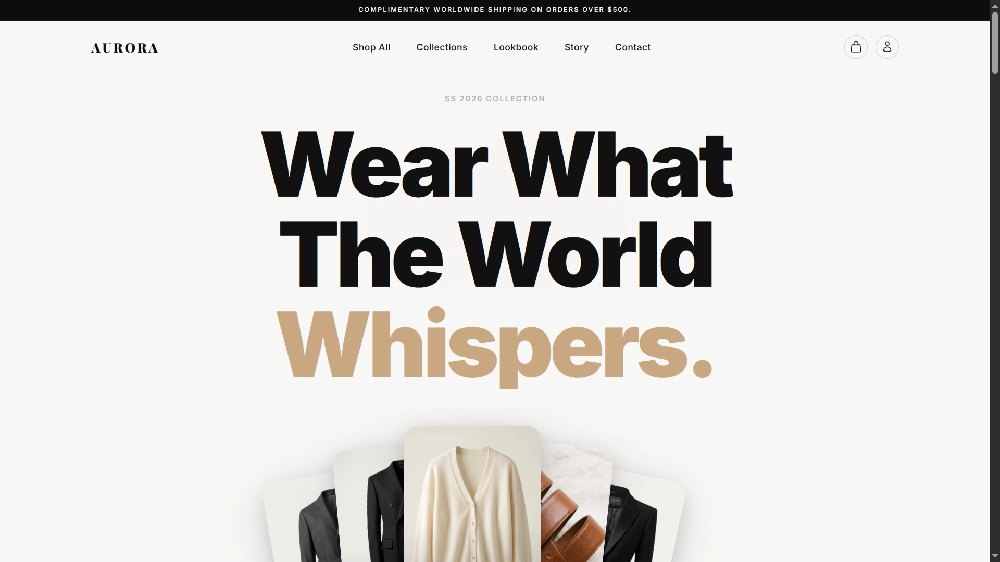
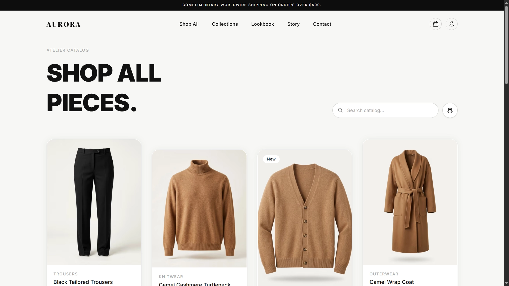
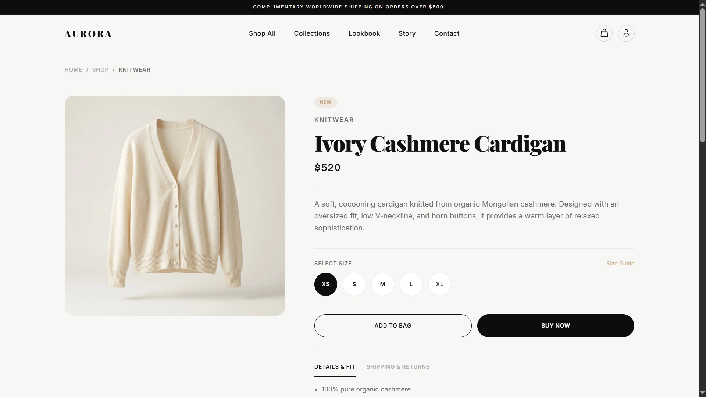
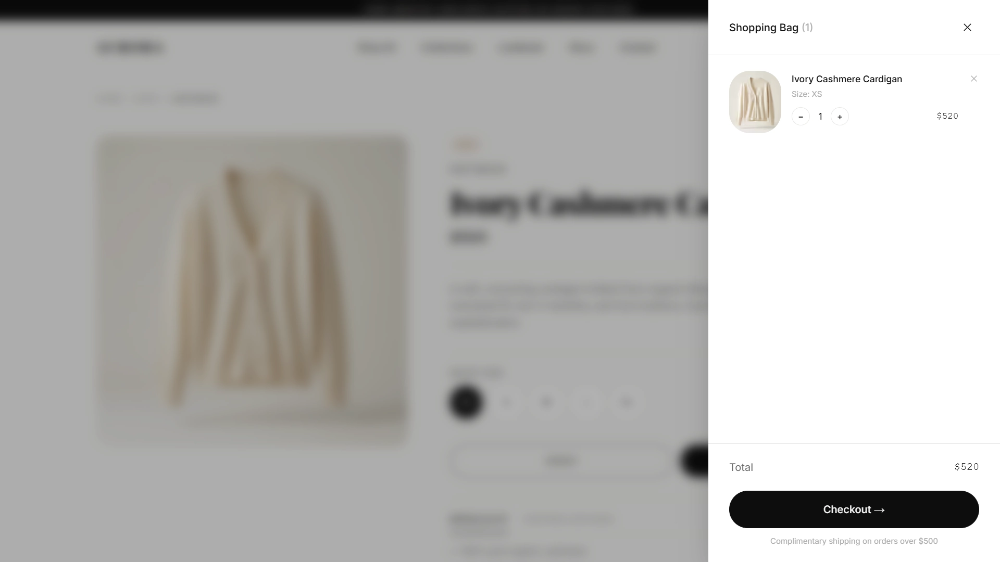
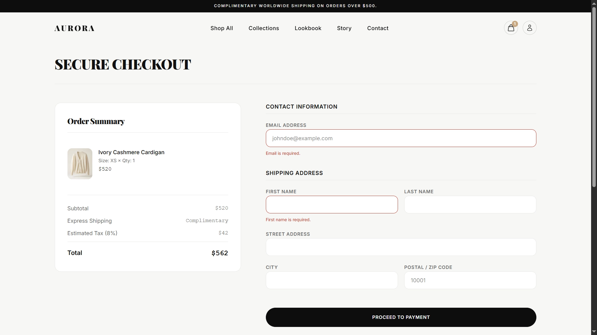
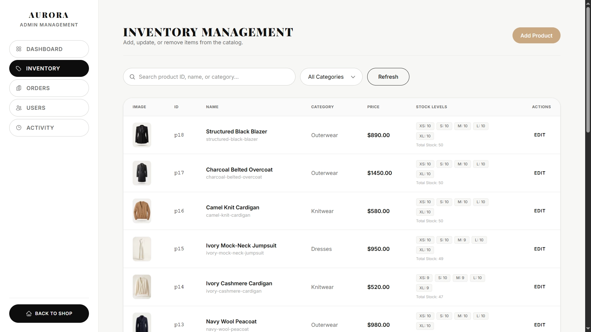
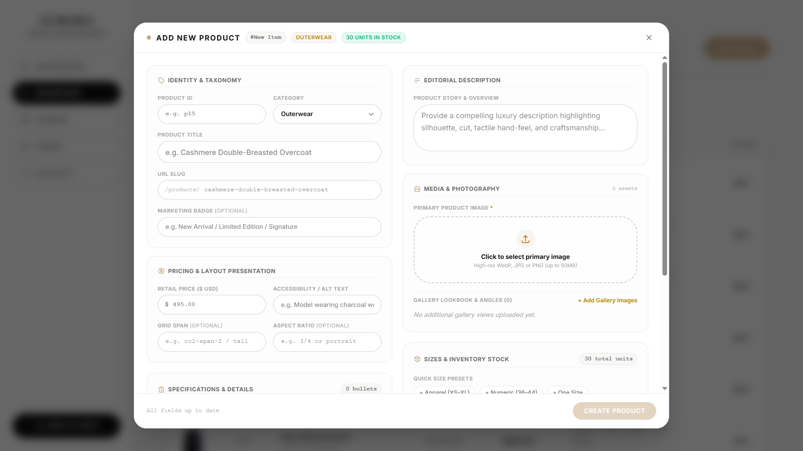

# 🌌 Aurora

### A Quiet-Luxury Digital Storefront — Minimalist, Editorial, Server-Rendered.

[](https://nextjs.org/)
[](https://react.dev/)
[](https://tailwindcss.com/)
[](https://www.postgresql.org/)
[](https://insforge.dev)
[](https://www.better-auth.com/)
[](https://www.lemonsqueezy.com/)
[](https://vercel.com/analytics)

---

## 🔗 Live Application & Demo Accounts

Explore the live digital storefront and administration panel:

* **Live Storefront**: [aurora-nu-three.vercel.app](https://aurora-nu-three.vercel.app/)
* **Repository**: [github.com/1ewig/aurora](https://github.com/1ewig/aurora)

### Demo Accounts

| Role | Email | Password | Access Privileges |
| :--- | :--- | :--- | :--- |
| **Customer** | `customer@example.com` | `Customer123!` | Personal profile, order history, checkout |
| **Admin** | `admin@example.com` | `Admin123!` | Full admin console, inventory CRUD, order fulfillment |

> [!TIP]
> **Guest Checkout** is default. Shoppers can browse pieces, select sizes, input address details, and checkout without authenticating or creating an account.

---

## ✨ The Product Experience

Aurora marries the aesthetic discipline of high-fashion editorial publishing with the transactional reliability of modern commerce engineering.

### 1. Curated Storefront & Editorial Identity
A minimalist design language inspired by print fashion journals. High-contrast typography paired with tailored cream tones, smooth entrances, and marquee highlights showcase the seasonal collection.



---

### 2. Brand Story & Textile Archives
Immersive editorial storytelling honoring atelier craftsmanship, heritage textiles (Mongolian cashmere, mulberry silk, fine merino wool), and interactive lookbook sliders.


---

### 3. The Atelier Catalog
Effortless catalog exploration featuring instant search, category filtering, and responsive product cards with hover animations. Category, sorting, and pagination states sync directly with URL query strings for effortless sharing.



---

### 4. Considered Product Detail (PDP)
Deep-dive garment presentations with high-resolution photography, interactive size selection, real-time availability badges, and structured tabs for tailored details, fabric care, and shipping terms.



---

### 5. Fluid Shopping Bag Drawer
A responsive slide-out bag with zero layout shifts. Displays live item totals, stock constraints, complimentary worldwide shipping thresholds, and local storage session persistence.



---

### 6. Zero-Friction Secure Checkout
Streamlined guest checkout by default. Built-in address validation, automated tax and shipping calculation, and instant payment handoff via the embedded Lemon Squeezy overlay.



---

### 7. Store Operator Back-Office
A dedicated admin back-office for operators. Features real-time inventory tracking, per-size stock monitors, low-stock warnings, order fulfillment transitions, and user management.



---

### 8. Streamlined Product Studio
An integrated administrative suite for managing the catalog. Easily create and edit garment listings, configure pricing and marketing badges, allocate per-size stock, and upload multi-angle photography.



---

## 🏛️ Architecture & Engineering Blueprint

While the storefront feels minimal and effortless, the underlying architecture is engineered for enterprise-grade integrity:

* **Strict 4-Layer Unidirectional Data Flow**: Pages (Server Components) $\to$ Client Orchestrators (`XxxClient.tsx`) $\to$ Hooks & Stores $\to$ Presentational UI (zero store/hook imports).
* **High-Concurrency Stock Control**: Pessimistic database row locks (`SELECT ... FOR UPDATE`), 35-minute soft stock reservations, and cryptographic HMAC webhook verification eliminate overselling and race conditions.
* **Direct SQL with Single-Roundtrip Aggregations**: Hand-written parameterized SQL using PostgreSQL `json_agg` eliminates N+1 queries and avoids ORM latency.
* **Next.js 16 Edge Protection & Caching**: Active edge proxy (`src/proxy.ts`) gates protected routes before rendering, while Next.js 16 `'use cache'` directives deliver sub-second response times.

### 📚 Technical Documentation & Deep-Dives

Detailed engineering specifications, database schemas, and coding guidelines live in dedicated guides:

| Document | Purpose |
| :--- | :--- |
| **[System Architecture Guide (`docs/SUMMARY.md`)](docs/SUMMARY.md)** | Single architecture reference: domain invariants, routing blueprints, concurrency lifecycles, and engineering rules. |
| **[Coding Standards (`docs/CODING_STANDARDS.md`)](docs/CODING_STANDARDS.md)** | Layer contracts, styling tokens, Framer Motion presets, and code cleanliness rules. |
| **[Backend & Deployment Guide (`docs/BACKEND_DEPLOYMENT.md`)](docs/BACKEND_DEPLOYMENT.md)** | PostgreSQL setup, InsForge storage buckets, Brevo SMTP configuration, and seeding pipelines. |
| **[Performance Rationale (`docs/performance-analysis.md`)](docs/performance-analysis.md)** | In-depth Core Web Vitals analysis, bundle sizes, caching strategies, and database query optimizations. |

---

## 🚀 Quick Start

Spin up Aurora locally in a few simple steps:

```bash
# 1. Clone repository and install dependencies
git clone https://github.com/1ewig/aurora.git
cd aurora
bun install

# 2. Configure environment variables
cp .env.example .env.local

# 3. Setup database and seed catalog assets
bun scripts/setup-db.js
bun scripts/upload-and-seed.mts

# 4. Start local development server
bun run dev
```

Visit `http://localhost:3000` to interact with your local environment.

---

## 🧪 Verification & Quality Control

Aurora maintains a strict verification pipeline:

```bash
# High-speed static analysis
bun run lint

# Vitest test suite (24 suites, 232 tests with mocked DB)
bun run test

# Next.js 16 production build & TypeScript validation
bun run build
```
